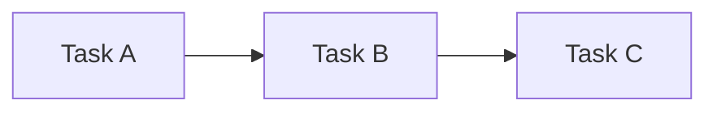

# Goal

Before architecture, frameworks or databases, we will practice separating the problem, requirements, constraints, assumptions, invariants, implementation choices, and failure modes.

# The problem

We need to execute a sequence of tasks in order.



A task is currently just a Python callable that takes no arguments and returns a string.

# Mental model: an assembly line

Imagine three workstations:

```text
Station A → Station B → Station C
```

If Station B breaks, we do not silently continue to Station C pretending nothing happened.

# Current requirements

1. Tasks execute in the order supplied.
2. Each task executes at most once during one call to `run_workflow`.
3. The returned list contains each task result in the same order.
4. An empty workflow returns an empty list.
5. If one task raises an exception, execution stops immediately.
6. The original exception is allowed to propagate to the caller.

# Current constraints

- Python only.
- No database.
- No FastAPI.
- No Docker.
- No queues.
- No retries.
- No design-pattern ceremony.
- No concurrency.

# Assumptions

- tasks run in the same process;
- tasks are synchronous;
- tasks require no input;
- task results are strings;
- we do not need to resume after a crash;
- we do not retry failures.

# First invariants

After a successful execution:

> the number of returned results equals the number of supplied tasks.

During an execution:

> a later task must never run before an earlier task completes successfully.

# Prediction exercise

Before writing code, answer in your learning journal:

1. What is the smallest implementation you can imagine?
2. What should happen if Task B raises an exception?
3. Which requirement would be violated if Task C still ran?
4. Is "use a class called Workflow" a requirement, constraint, or implementation choice?
5. What information would be lost if the Python process dies halfway through?

# Implementation exercise

Open `src/workflow_engine/engine.py` and implement `run_workflow`.

Run:

```bash
uv run pytest tests/test_lego_00.py -q
```

# Failure experiment

After your tests pass, run:

```bash
uv run python labs/lego_00/failure_experiment.py
```

# Completion criteria

Do not mark Lego 00 complete until you can explain without reading:

- requirement vs constraint;
- assumption vs invariant;
- failure mode;
- why the current implementation is intentionally simple;
- at least two things this implementation cannot do reliably.
